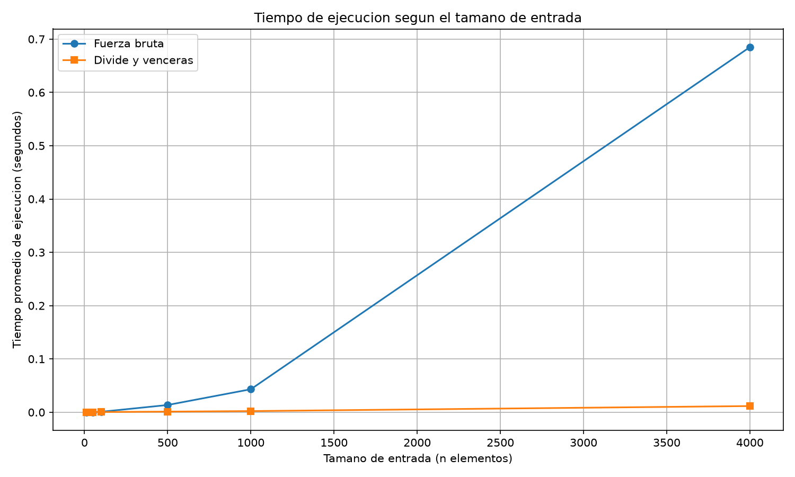

# Laboratorio 2 — Dividir y vencerás

**Asignatura:** Análisis de Algoritmos  
**Estudiante:** Geremy Santa Duque
**Tema:** Máxima suma de un subarreglo 

## Cómo reproducir el experimento

Desde la carpeta `lab2-divide-y-vencer`, ejecutar los siguientes comandos en Windows:

```bash
python -m venv .venv
.venv\Scripts\activate
python -m pip install matplotlib
python pruebas.py
python medicion.py
```

Al ejecutar `medicion.py`, se generará la gráfica `graficas/tiempo_vs_n.png`. La semilla fija permite reproducir los datos de entrada; los tiempos pueden variar entre ejecuciones y equipos.

## Parte 1. Implementación y verificación

Los algoritmos están implementados en [`subarreglo.py`](subarreglo.py) y las pruebas se encuentran en [`pruebas.py`](pruebas.py).

Para verificar su funcionamiento, se probaron casos con un solo elemento, valores completamente negativos, valores positivos, una racha que cruza el punto medio y el ejemplo del enunciado, cuya suma máxima es 17. También se compararon ambos algoritmos con 20 listas aleatorias. Las comprobaciones verifican que las sumas máximas coincidan y que la lista original no sea modificada.

## Parte 2. Medición y gráfica

El experimento está implementado en [`medicion.py`](medicion.py). Se utilizó una semilla fija para generar valores enteros entre -100 y 100, y se evaluaron arreglos de 10, 50, 100, 500, 1.000 y 4.000 elementos. Para cada tamaño se utilizó la misma lista en ambos algoritmos y se calculó el promedio de tres mediciones, tomando el tiempo únicamente durante la ejecución de cada algoritmo.

La gráfica compara los tiempos obtenidos en los dos métodos.



## Parte 3. Análisis de resultados

El algoritmo de divide y vencerás divide el arreglo en dos mitades, resuelve cada una recursivamente y después encuentra la suma que cruza el punto medio. Como realiza dos llamadas sobre arreglos de tamaño aproximado `n/2` y el recorrido para encontrar la suma cruzada cuesta `Θ(n)`, su recurrencia es `T(n) = 2T(n/2) + Θ(n)`. Aplicando el método maestro, `a = 2`, `b = 2` y `n^(log₂ 2) = n`. Como `f(n) = Θ(n)`, se cumple el caso 2 y la complejidad resultante es `Θ(n log n)`. En cambio, fuerza bruta revisa todos los tramos posibles y acumula sus sumas mediante ciclos anidados. Esto representa aproximadamente `n(n + 1)/2` operaciones, por lo que su complejidad es `Θ(n²)`.

Al observar la gráfica, se nota que las dos curvas aumentan cuando crece el tamaño del arreglo, pero lo hacen de manera diferente. En los tamaños pequeños, los tiempos son muy bajos y la diferencia entre los algoritmos es mínima: con 10 elementos, fuerza bruta tarda 0,000016 s y divide y vencerás 0,000036 s, por lo que en este caso resulta más rápido recorrer directamente los posibles tramos. Sin embargo, a medida que aumenta la cantidad de datos, la curva de fuerza bruta comienza a subir mucho más rápido, mientras que la de divide y vencerás crece de forma más moderada. Esto se nota especialmente con 4.000 elementos: fuerza bruta tarda 0,684927 s, mientras que divide y vencerás tarda 0,011599 s. Las mediciones realizadas muestran que fuerza bruta resulta más rápido con 10 elementos, pero a partir de 100 elementos divide y vencerás empieza a mostrar una eficiencia en los tiempos de ejecución. Para observar el crecimiento, comparé los tiempos de 500 y 1.000 elementos, donde se duplica el tamaño. El factor se calcula dividiendo el tiempo nuevo entre el anterior. En fuerza bruta, `0,043154 / 0,013593 ≈ 3,17`; en divide y vencerás, `0,002165 / 0,001167 ≈ 1,86`. El primer valor se acerca al factor 4 esperado al duplicar una entrada con `Θ(n²)`. El segundo se acerca a 2, aunque el crecimiento `n log n` depende también del logaritmo del tamaño.

Teniendo en cuenta lo anterior, podemos deducir que esto también explica por qué dividir no siempre mejora cualquier problema. Si solo se necesita encontrar el mayor número de un arreglo, basta con recorrerlo una vez y conservar el mayor valor encontrado, con costo `Θ(n)`. Dividirlo produciría la recurrencia `T(n) = 2T(n/2) + Θ(1)`, cuya solución también es `Θ(n)`. En ese caso, dividir no mejora el orden de complejidad y tiene un incremento al realizar las llamadas recursivas.

Para la cooperativa recomendaría divide y vencerás, porque al trabajar con miles de registros ya presenta una ventaja y esa diferencia puede ser mucho más importante cuando el volumen de información aumenta, tal como fue expresado en el párrafo numero dos. Para tener una idea de lo que podría ocurrir con un millón de registros, realizamos una estimación, no una medición directa. Se toma como punto de partida los resultados con 4.000 elementos donde tardó `0,011599 s`para divide y venceras, frente a `0,684927 s` de fuerza bruta. Con lo anterior se puede estimar que fuerza bruta tardaría cerca de 11,9 horas, mientras que divide y vencerás tardaría aproximadamente 4,8 segundos.El tiempo real puede variar pero la diferencia que se evidencia en la estimación muestra que el algortimo propuesto seria mucho más óptimo para una cantidad grande de datos. 
