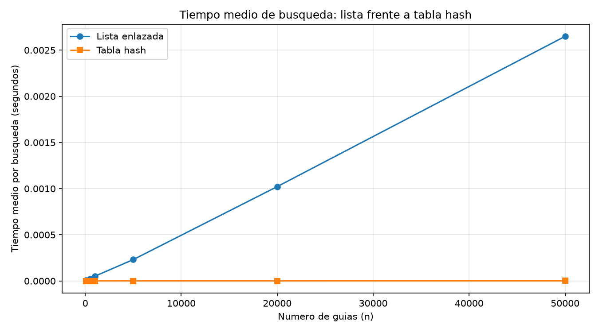
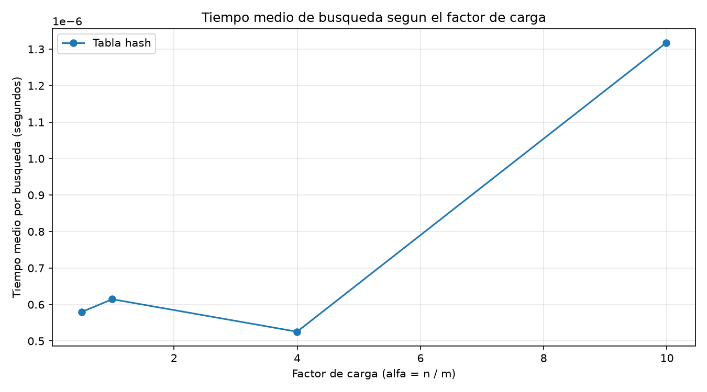

# Laboratorio 3 — Estructuras de datos

**Asignatura:** Análisis de Algoritmos  
**Estudiante:** Geremy Santa Duque  
**Tema:** Comparación entre lista enlazada y tabla hash  
**Caso de estudio:** Rutas del Caribe — empresa de mensajería

## Instrucciones para reproducir el experimento

Para ejecutar las pruebas y generar las gráficas, primero se debe activar el entorno virtual del repositorio y asegurarse de tener instaladas las dependencias registradas en `requirements.txt`.

Desde la raíz del repositorio, en PowerShell, ejecutar:

```powershell
.\venv\Scripts\Activate.ps1
pip install -r requirements.txt
```

Después, entrar a la carpeta del laboratorio:

```powershell
cd laboratorios\lab3-estructuras-datos
```

Para ejecutar las pruebas de las estructuras:

```powershell
python pruebas.py
```

Para realizar las mediciones y generar las gráficas:

```powershell
python medicion.py
```

El primer comando verifica el funcionamiento de las estructuras mediante pruebas con `assert`. El segundo ejecuta los dos experimentos y guarda las imágenes en la carpeta `graficas/`.

## Parte 1 — Implementar y verificar las dos estructuras

**Archivos de código:**

- [`estructuras.py`](estructuras.py): contiene las clases `Nodo`, `ListaEnlazada` y `TablaHash`.
- [`pruebas.py`](pruebas.py): contiene las pruebas de búsqueda exitosa e infructuosa, colisiones y comparación de resultados entre las estructuras.

Para resolver el problema de las consultas de guías, se implementaron dos estructuras: una lista enlazada y una tabla hash con encadenamiento.

La lista enlazada almacena cada guía junto con su estado y permite agregar elementos al inicio. Luego lo que hace para buscar una guía, es recorrer los nodos hasta encontrarla o llegar al final. Esto funciona correctamente, aunque las consultas de guías inexistentes obligan a recorrer toda la lista.

La tabla hash calcula la posición de cada guía mediante el método de la división, utilizando el residuo de dividir la guía entre el número de casillas. Cuando varias guías llegan a una misma posición, se almacenan en una lista enlazada dentro de esa casilla. De esta manera, se reutiliza la lista enlazada para resolver las colisiones.

Para verificar las colisiones, se hizo uso de una tabla con siete casillas. Las guías 10, 24 y 17 llegan a la casilla 3 y pueden recuperarse correctamente después de insertarlas. También se comprobó el factor de carga y se realizaron las pruebas con colecciones aleatorias para comparar las respuestas de ambas estructuras.

## Parte 2 — Medir y graficar

**Archivo de código:**

- [`medicion.py`](medicion.py): contiene la generación de datos, las verificaciones, las mediciones y el código para producir las gráficas.

Para comparar el rendimiento, se mide el tiempo medio de búsqueda de guías inexistentes. Se elige en este caso porque, en la lista enlazada, es necesario recorrer todos los elementos antes de concluir que la guía no se encuentra almacenada.

Se utilizaron seis tamaños de entrada: 100, 500, 1.000, 5.000, 20.000 y 50.000 guías. Para cada tamaño fueron 200 búsquedas en cada estructura. La tabla hash se construyó con un número primo de casillas cercano a la mitad del número de guías, manteniendo el factor de carga alrededor de 2.

| Cantidad de guías (`n`) | Tamaño de la tabla (`m`) | Factor de carga aproximado |
|------------------------:|---:----------------------|---:------------------------|
|           100           |             47           |             2,13           |
|           500           |            251           |             1,99           |
|          1.000          |            499           |             2,00           |
|          5.000          |           2.503          |             2,00           |
|         20.000          |          10.007          |             2,00           |
|         50.000          |          24.989          |             2,00           |

En el segundo experimento se mantuvieron 20.000 guías y se cambiaron el número de casillas para observar cómo influye el factor de carga en el tiempo de búsqueda. Finalmente se realizaron las pruebas con cuatro valores solicitados: 0,5, 1, 4 y 10.

Las guías se generaron con semillas fijas para poder repetir los experimentos. Además, se tuvo en cuenta el uso de `time.perf_counter()` para medir exclusivamente las búsquedas, sin incluir la construcción de las estructuras ni la generación de los datos.

### Gráfica 1. Lista enlazada frente a tabla hash

Esta gráfica compara el tiempo medio por búsqueda a medida que aumenta el número de guías.



### Gráfica 2. Efecto del factor de carga

Esta gráfica permite observar cómo cambia el tiempo de búsqueda en la tabla hash al aumentar el número promedio de guías por casilla.

.

## Parte 3 — Análisis de los resultados

## 1. Costo teórico

En una lista enlazada, buscar una guía que no existe implica recorrer todos los nodos, porque no hay una forma directa de saber dónde se encuentra la guía. Por eso, si aumenta el número de guías, por lógica también en este caso aumentaría el trabajo que debe hacerse. Su costo es Θ(n).

En la tabla hash, en cambio, lo que hacemos es calcular una posición a partir del número de guía y revisamos únicamente la lista de esa casilla. En promedio, su costo es Θ(1 + α), donde α representa el número de guías por casilla. Esto lo que hace es suponer que la función hash distribuye las guías de manera suficientemente uniforme. Si todas terminaran en la misma casilla, la tabla perdería su ventaja y la búsqueda podría costar Θ(n).

## 2. Lo medido contra lo esperado

En la primera gráfica podemos comparar los resultados de 20.000 y 50.000 guías. El tamaño para este ejemplo es que aumentó 2,5 veces. En la lista enlazada, el tiempo pasó de 0,00102181 a 0,00264929 segundos, es decir, aumentó aproximadamente 2,59 veces. Esto se acerca al crecimiento lineal esperado, ya que una búsqueda infructuosa debe revisar todas las guías.

En la tabla hash, el tiempo pasó de 0,00000079 a 0,00000113 segundos, aproximadamente 1,43 veces. Aunque no permaneció exactamente igual, su variación fue mucho menor. Esto es coherente con un comportamiento cercano a Θ(1) respecto a n, siempre que el factor de carga se mantenga controlado.

Como factor por analizar es la segunda gráfica, ya que al pasar de un factor de carga de 0,5 a uno cercano que es  10, el tiempo aumentó de 0,00000058 a 0,00000132 segundos. Lo que se puede evidenciar es la tendencia general de que tener más guías por casilla puede hacer más lenta la búsqueda. Sin embargo, el crecimiento no es perfectamente proporcional a α, y lo anterior es bastante razonable en mediciones tan pequeñas, donde también influye el ruido del cronometraje.

## 3. Explique las colisiones

Una colisión  puede definirse como lo que ocurre cuando dos o más guías terminan en la misma casilla. Lo anterior puede pasar incluso cuando la presencia de casillas es superior que las guías, porque la función hash no garantiza que cada guía tenga una posición exclusiva.

En nuestras pruebas, con m = 7, las guías 10, 24 y 17 producen el mismo resultado: 3. Para resolverlo utilizamos encadenamiento, que lo que hace en este caso es guardar las tres guías en una lista enlazada dentro de esa casilla. Su ventaja es que resulta sencillo de implementar y permite manejar varias guías en una misma posición; el costo que se tiene es que hay que recorrer esa lista cuando ocurren colisiones.

Otra alternativa a esta problematica es el direccionamiento abierto, que basicamente es buscar otra casilla disponible siguiendo una regla determinada. Esta alternativa puede aprovechar el arreglo sin crear una lista para cada posición, pero lo que se requiere es poder controlar las casillas ocupadas y su rendimiento puede disminuir cuando la tabla está muy llena.

## 4. Tabla hash o árbol de búsqueda

Para consultar una guía puntual, la tabla hash puede ser una gran opción. Sin embargo, para pedir todas las guías entre un rango (número X y otro Y), no es la herramienta más adecuada y como justificación es que sus posiciones dependen de la función hash, no del orden numérico de las guías.

Teniendo en cuenta la opción de un árbol de búsqueda binario, esta opción sí permite organizar las claves de menor a mayor y al mismo tiempo poder recorrer únicamente las que están dentro de un rango, especialmente si el árbol está equilibrado.

Si ponemos el caso de prueba de insertar las 400.000 guías ya ordenadas en un árbol binario sin equilibrarlo, este puede convertirse en una estructura parecida a una lista. Haciendo un estimado su altura sería de aproximadamente 399.999 enlaces y una búsqueda en el peor caso podría necesitar cerca de 400.000 comparaciones. Realizando el contraste con un árbol equilibrado, la altura sería de unos 19 niveles y una búsqueda necesitaría alrededor de 19 o 20 comparaciones teniendo en cuenta que se toma el peor caso.

## 5. Concepto para la jefa de operaciones

Según nuestros resultados, lo que recomendaría es combinar las estructuras: una tabla hash para las consultas puntuales del call center y un árbol binario de búsqueda equilibrado para el monitoreo por rangos. De esta manera, cada necesidad se atiende con la estructura más adecuada.

Para estimar el comportamiento con 5.000.000 de envíos, tomamos como referencia la medición realizada con 50.000 guías. La lista enlazada tardó 0,00264929 segundos por búsqueda infructuosa. Como la cantidad de guías aumenta 100 veces, si el comportamiento se mantiene aproximadamente lineal, el tiempo estimado sería de 0,264929 segundos por búsqueda.

En la tabla hash, la medición fue de 0,00000113 segundos. Si se mantiene un factor de carga cercano a 2 y las guías se distribuyen adecuadamente, el tiempo esperado seguiría siendo mucho menor que el de la lista y podría mantenerse en el orden de los microsegundos. Sin embargo, esta cifra es una estimación basada en los resultados obtenidos, no una medición real con cinco millones de envíos.

Dando un poco de profundidad a la justificación de este punto, las curvas respaldan esta recomendación: el tiempo de la lista aumenta aproximadamente en proporción a la cantidad de elementos, mientras que el de la tabla hash presenta variaciones pequeñas en las pruebas realizadas. En la práctica, el hardware, el consumo de memoria y la distribución de las guías pueden modificar los tiempos. Por eso, conviene utilizar la tabla hash para las consultas puntuales y un árbol equilibrado para las consultas por rangos, que requieren mantener los datos ordenados.
